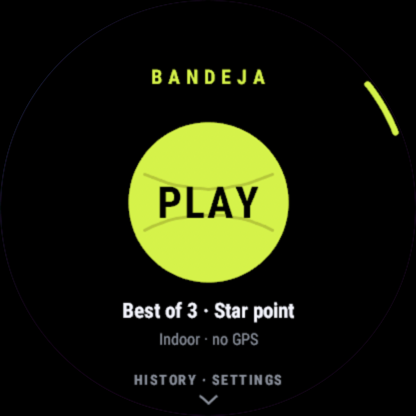
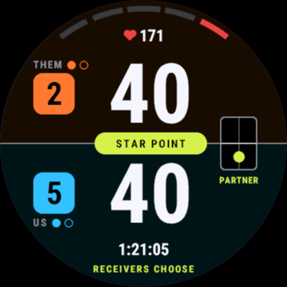
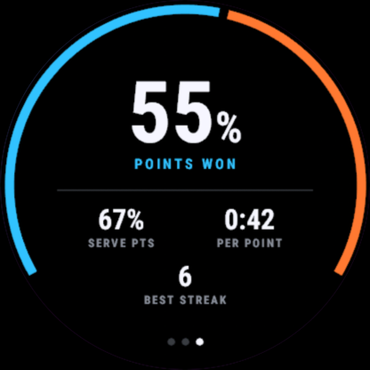
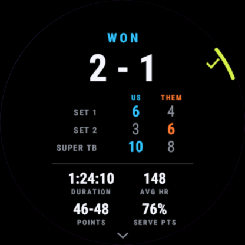
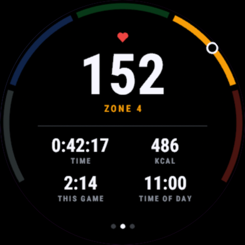

# Bandeja

A padel score keeper for Garmin watches with a round AMOLED screen: with five buttons, the Forerunner 70, 165, 170, 265, 570, 965 and 970, fēnix 8, 9 and E, epix (Gen 2) and epix Pro (Gen 2), Instinct 3 AMOLED, Descent Mk3 and G2, D2 Mach, MARQ (Gen 3) and MARQ Aviator (Gen 2), with their quatix and tactix editions; scored by touch, the Venu 2, 2 Plus, 2S, 3, 3S and 4, vivoactive 5 and 6, D2 Air X10 and Approach S50, S70 and S72 ([the full list](#build-from-source)). One button press (or one touch) per point: the watch handles the rules (deuce modes, tie-breaks, serve rotation, change of ends) and saves the match to Garmin Connect as a **Padel** activity, with heart rate, calories, training effect, the final score, one lap per game and the match stats.

**[Get it free on the Connect IQ store](https://apps.garmin.com/apps/eb45fd94-cf4e-4d44-aa3c-3322c38a6e2e)**

<p>
  
  
  
  
  
</p>

## Features

- **Every common format**: Best of 3, Best of 3 with a super tie-break, 1 set, Pro set, Short sets, Best of 5, Tie-break to 7 or 10, Free play (no end) and Custom (games per set, tie-break at N-N or (N-1)-(N-1), tie-break to 7 or 10, or no tie-break).
- **Deuce modes**: Advantage, Golden Point, Star Point (FIP 2026) and Silver Point, changeable mid-match. Banners show DEUCE 1, DEUCE 2, STAR POINT, BREAK POINT, SET POINT and MATCH POINT.
- **Serve tracking**: who serves, from which side, the rotation across games, tie-breaks and sets, with corrections from the menu. Doubles or singles, mixed doubles.
- **Timed match**: enter when the court booking ends; the watch warns at 10 and 5 minutes left and at the end time.
- **Change of ends alerts**, on screen and on the wrist.
- **Unlimited undo**, also after the match ends, and **Edit score** to start a match already in progress.
- **Never loses a score**: the match is stored after every point and resumes after a crash or a restart.
- **Stats** on the watch and in Connect: points won, serve and return points won, holds and breaks, break points, deciding points, tie-breaks, average time per point, longest streak.
- **History** of the last 20 matches, and a glance with the last result.
- **Themes** (Court, Clay, Grass), team names, adjustable press delay, optional touch scoring.
- English and French.

## Buttons

| Button | Press | Hold |
|---|---|---|
| UP | Point for THEM (top of the screen) | Match menu (the timer keeps running) |
| DOWN | Point for US (bottom of the screen) | |
| BACK / LAP | Undo the last event | |
| START / STOP | Pause, and the pause menu | |

Points count when the button is released, so holding UP for the menu never scores. Two presses within the press delay (0.8 s by default) count as one point. Swipe left for the data page (time, heart rate, calories) and the stats page, or open them from the match menu (hold UP), as on the Instinct 3 AMOLED, which has no touchscreen. With touch scoring on, a tap on the top or bottom half of the score page scores for that team.

On the Venu, vivoactive, D2 Air X10 and Approach watches, which give apps no UP and DOWN, you score by touch:

| Input | During a match |
|---|---|
| Tap the top or bottom half of the score page | Point for THEM or US (Touch scoring: Tap, the default) |
| Touch and hold a half | Point for that team instead, once per hold (Touch scoring: Hold; a tap then does nothing) |
| BACK | Undo the last event on the score page; back to the score page from the data and stats pages |
| START | Pause, and the pause menu |
| Swipe up | Match menu (also hold BACK, or the Approach S70's middle button, where the watch has it) |
| Swipe left / right | Data page and stats page, then round to the score page / the page before |

A swipe up also opens the warm-up's menu and, from the summary's last page, its menu. The match menu lists the settings and pages first and the score corrections last. The touch scoring and its gesture are checked in the simulator only so far; please report how they behave on your watch.

## In Garmin Connect

The match is saved as a Padel activity (sport Racket, sub-sport Padel), so Connect computes calories, training effect, exercise load and intensity minutes as for the native activity. Bandeja adds:

- **Session fields**: the score (`6-4 3-6 10-8`), sets, games and points won and lost, serve and return points won, breaks won, deciding points, and the result.
- **One lap per game**, with its set, the set score and the game's outcome (which team held or broke serve, or a tie-break).
- **A momentum chart**: the point difference over the match.

Connect shows these fields only for the app installed from the Connect IQ store, not for a sideloaded build.

## Privacy

Bandeja makes no network requests. The only data that leaves the watch is the activity it saves, which syncs to Garmin Connect like any other activity. GPS is used only when you pick Outdoor; heart rate comes from the watch's sensor (or a paired chest strap), and the heart rate zones from your Garmin profile.

## Settings

On the watch (Settings, in the home screen's list) and in the app's settings in the Garmin Connect app: serve tracking, warm-up phase, vibration, sounds (not on the watch's menus where it plays no tones: Venu 2 and 2S, vivoactive 5 and 6), change of ends alert, touch scoring (not on the watch's menus without a touchscreen; on the watches scored by touch it is always on, and the setting picks Tap or Hold, "Touch gesture" in the Garmin Connect app), press delay and theme. Team names are typed in the Garmin Connect app only. Indoor or Outdoor and the timed match are picked in the Format menu.

## Build from source

Watches (`manifest.xml`, Connect IQ product IDs):

| Screen | Watches |
|---|---|
| 360 px | Forerunner 265S (`fr265s`); scored by touch: Venu 2S (`venu2s`) |
| 390 px | Forerunner 70, 165, 165 Music, 170, 170 Music, 570 42mm (`fr70`, `fr165`, `fr165m`, `fr170`, `fr170m`, `fr57042mm`), epix Pro (Gen 2) 42mm (`epix2pro42mm`), Descent Mk3 43mm and G2 (`descentmk343mm`, `descentg2`), Instinct 3 AMOLED 45mm (`instinct3amoled45mm`), MARQ Aviator (Gen 2) (`marq2aviator`); scored by touch: Venu 3S and 4 41mm (`venu3s`, `venu441mm`), vivoactive 5 and 6 (`vivoactive5`, `vivoactive6`), Approach S50 and S70 42mm (`approachs50`, `approachs7042mm`) |
| 416 px | Forerunner 265 (`fr265`), fēnix 8 43mm, 9 43mm, 9 Pro 43mm and E (`fenix843mm`, `fenix943mm`, `fenix9pro43mm`, `fenixe`), epix (Gen 2) and epix Pro (Gen 2) 47mm (`epix2`, `epix2pro47mm`), D2 Mach 1 (`d2mach1`), Instinct 3 AMOLED 50mm (`instinct3amoled50mm`); scored by touch: Venu 2 and 2 Plus (`venu2`, `venu2plus`), D2 Air X10 (`d2airx10`), Approach S72 43mm (`approachs7243mm`) |
| 454 px | Forerunner 570 47mm, 965 and 970 (`fr57047mm`, `fr965`, `fr970`), fēnix 8 47mm, 8 Pro 47mm, 9 47mm and 9 Pro 47mm (`fenix847mm`, `fenix8pro47mm`, `fenix947mm`, `fenix9pro47mm`), epix Pro (Gen 2) 51mm (`epix2pro51mm`), Descent Mk3i 51mm (`descentmk351mm`), D2 Mach 2 and Mach 2 Pro (`d2mach2`, `d2mach2pro`), MARQ (Gen 3) (`marq3`); scored by touch: Venu 3 and 4 45mm (`venu3`, `venu445mm`), Approach S70 47mm and S72 47mm (`approachs7047mm`, `approachs7247mm`) |
| 466 px | fēnix 9 Pro 51mm (`fenix9pro51mm`) |

The screens are drawn from the FR265's 416 px design, scaled to each screen. The Descent G2, the Instinct 3 AMOLED, the Venu 2, 2 Plus and 2S, the vivoactive 5, the D2 Air X10 and the Approach S50 have no vector fonts, and the Venu 3 and 3S none in Roboto Condensed: their builds bundle Roboto Condensed as bitmap fonts, in folders by screen size (`bundled-fonts/`, made by `scripts/make-fonts.sh`). The watches scored by touch build their input rules from the `(:noScoreButtons)` annotation (`monkey.jungle`, `source/ui/InputFlags.mc`).

Requirements:
- The [Connect IQ SDK](https://developer.garmin.com/connect-iq/sdk/), installed with the SDK Manager, with the devices you build for.
- A developer key (`~/.garmin/developer_key.der`, or set `CIQ_KEY`).
- macOS: `scripts/dev.sh` relies on the SDK Manager's macOS paths. Copying to a watch needs libmtp (`brew install libmtp`).

```sh
scripts/dev.sh build fr265     # debug build: bin/bandeja-fr265.prg
scripts/dev.sh run fr265s      # build and launch in the simulator
scripts/dev.sh test fr265      # run the unit tests in the simulator
scripts/dev.sh export          # release package for the store: bin/bandeja.iq
scripts/dev.sh deploy          # copy a build to a watch plugged in over USB
```

Every build uses strict type checking and fails on any compiler warning. The VS Code Monkey C extension picks up the same settings from `.vscode/settings.json`.

Layout:
- `source/engine/`: the scoring engine, pure logic with no UI or recording code.
- `source/recording/`: the activity session, laps and FIT developer fields.
- `source/storage/`: settings, the stored match and the history.
- `source/ui/`, `source/glance/`: screens, menus and input.
- `source/tests/`: the unit tests (`(:test)` functions, left out of release builds).
- `resources/`, `resources-fre/`: strings (English, French), settings and FIT field definitions.
- `launcher-icons/`, `bundled-fonts/`: resources for some watches only (`monkey.jungle`): the launcher icon at their size, the bundled fonts for their screen size.

## License

[MIT](LICENSE). The bundled fonts (`bundled-fonts/`) are Roboto Condensed, under the [Apache License 2.0](bundled-fonts/LICENSE).

Bandeja is not affiliated with or endorsed by Garmin. Garmin, Forerunner, Connect IQ and Garmin Connect are trademarks of Garmin Ltd. or its subsidiaries.
